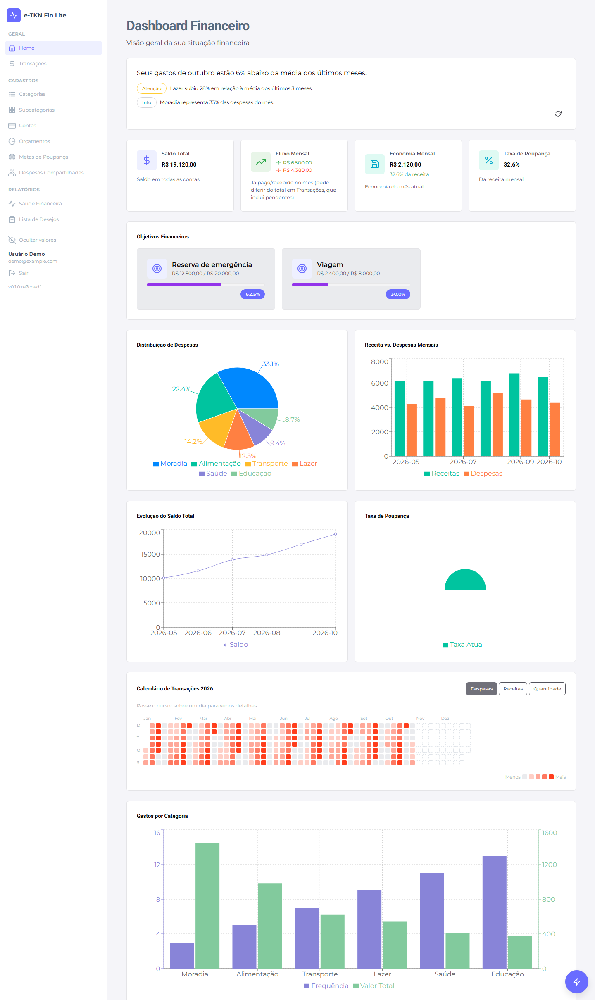

# e-TKN Fin Lite

App de finanças pessoais em português do Brasil: saldo, receitas e despesas, orçamentos, metas de poupança, despesas compartilhadas e insights gerados por IA. Este repositório é o **front-end** (Next.js); os dados vêm da API [`tkn_finance_api`](../tkn_finance_api).



> A imagem usa dados fictícios de demonstração.

## Funcionalidades

| Área | Rota | O que faz |
|---|---|---|
| Dashboard | `/` | Saldo total, fluxo e economia do mês, metas, distribuição de despesas, receita vs. despesa, evolução do saldo, taxa de poupança, calendário de transações (heatmap) e insights de IA |
| Transações | `/transaction` | Listagem com filtros e período, criação/edição, pagamento de transações planejadas e classificação *planejada vs. não planejada* |
| Importar extrato | `/transaction/import` | Importa extratos CSV do PicPay, classifica as linhas por regras de categoria, permite revisar antes de salvar e evita duplicatas |
| Entrada rápida | botão flutuante | Digite uma frase ("mercado 87,50 ontem"); a API interpreta e abre o formulário pré-preenchido. Nada é salvo até confirmar |
| Categorias / Subcategorias / Contas | `/category`, `/subcategory`, `/account` | Cadastros básicos |
| Orçamentos | `/budget` | Limites por categoria com alertas |
| Metas de poupança | `/savings-goal` | Metas com depósito, retirada e previsão de conclusão |
| Despesas compartilhadas | `/shared-expense-group` | Grupos, divisão de despesas e acertos entre membros |
| Saúde financeira | `/financial-health` | Dívidas, recebíveis, economia líquida, próximos vencimentos e tendência de 3 meses |
| Lista de desejos | `/wishlist` | Itens desejados com status |

Também há o botão de ocultar valores na Sidebar, que mascara todos os valores monetários.

## Stack

- [Next.js 14](https://nextjs.org/) (App Router), React 18 e TypeScript
- [Chakra UI v3](https://www.chakra-ui.com/) com o design system interno [`tikin-uai`](https://www.npmjs.com/package/tikin-uai) (tema, `DataTable`, `PageHeader`)
- [Recharts](https://recharts.org/) para os gráficos
- `react-feather` (ícones) e `sweetalert` (confirmações)
- Autenticação com Google Identity Services + sessão emitida pela API

> **Migração de UI em andamento:** o app está saindo do Bootstrap 5 para o `tikin-uai`/Chakra. As páginas ainda não migradas importam o próprio CSS do Bootstrap. Detalhes e convenções em [CLAUDE.md](CLAUDE.md).

## Como rodar

Pré-requisitos: Node.js 20+ e a API rodando (por padrão em `http://localhost:8081`).

```bash
npm install
# crie o .env.local com as variáveis abaixo (NEXT_PUBLIC_GOOGLE_CLIENT_ID é obrigatória para o login)
npm run dev                        # http://localhost:3000
```

### Variáveis de ambiente

| Variável | Descrição | Padrão |
|---|---|---|
| `NEXT_PUBLIC_API_URL` | Base da API vista pelo navegador. Use sempre `/api` (mesma origem) | `/api` |
| `NEXT_PUBLIC_GOOGLE_CLIENT_ID` | Client ID do Google para o login | — |
| `NEXT_PUBLIC_APP_TIMEZONE` | Fuso para exibir datas em formato instante; deve ser igual ao `APP_TIMEZONE` da API | `America/Sao_Paulo` |
| `API_PROXY_TARGET` | Destino do proxy `/api/*` em desenvolvimento | `http://localhost:8081` |

Em desenvolvimento, o `next.config.mjs` encaminha `/api/:path*` para `API_PROXY_TARGET`, replicando o nginx de produção (mesma origem, o cookie de refresh continua *same-origin*). Não chame `localhost:8081` direto nem use `fetch` nas páginas: use `src/lib/api/*`.

### Scripts

| Comando | Descrição |
|---|---|
| `npm run dev` | Servidor de desenvolvimento |
| `npm run build` | Build de produção (`output: standalone`) |
| `npm run lint` | ESLint (`next lint`) |
| `npm run release` | Gera versão, changelog e tag (ver [docs/RELEASE.md](docs/RELEASE.md)) |
| `npm run deploy:rasp` | Build e publicação no Raspberry Pi via SSH/pm2 (`scripts/deploy-rasp.sh`) |

Não há suíte de testes automatizados neste projeto.

## Arquitetura

```
src/
├── app/                  # rotas (App Router); cada CRUD é uma página "use client" com estado local
│   ├── layout.tsx        # layout raiz: providers + AuthShell (Sidebar/FAB só em rotas autenticadas)
│   ├── providers.tsx     # ChakraProvider (tema tikin-uai) + AuthProvider + HideValuesProvider
│   └── <rota>/page.tsx
├── components/
│   ├── Sidebar.tsx, AuthShell.tsx, AuthGate.tsx, FloatingActionButton.tsx
│   ├── dashboard/        # cards, gráficos, heatmap e insights da home e da saúde financeira
│   ├── transaction/      # formulário, filtros, pagamento, entrada rápida e revisão de extrato
│   └── common/           # MoneyInput etc.
├── contexts/             # AuthContext e HideValuesContext
└── lib/
    ├── api/              # um módulo por recurso + http.ts (cliente com refresh de sessão)
    ├── auth/session.ts   # access token só em memória
    ├── statement/        # parser e classificação de extratos (PicPay)
    ├── types/, hooks/, ui/, utils/
    └── version.ts        # versão + commit injetados no build
```

**Autenticação:** `/login` envia a credencial do Google para `POST /auth/google` e recebe `{ accessToken, user }`, além de um cookie httpOnly de refresh. O token fica apenas em memória; em um `401`, o `http.ts` faz um único `POST /auth/refresh` (compartilhado entre requisições paralelas) e repete a chamada. Se o refresh for recusado, a sessão termina e o usuário volta ao `/login`.

**Convenções úteis:**
- Moeda: `Intl.NumberFormat('pt-BR', { style: 'currency', currency: 'BRL' })` (ou o hook `useFormatCurrency`).
- Datas `YYYY-MM-DD`: nunca use `new Date(string)` (fuso UTC desloca o dia); separe em partes e use `new Date(ano, mes - 1, dia)`.
- Tipo de transação: `'EXPENSE' | 'INCOME'`.

O guia completo para desenvolvimento (e para o Claude Code) está em [CLAUDE.md](CLAUDE.md).

## Deploy

O front é publicado junto com a API e um nginx (rota `/api/*` → API, o resto → front). Veja [`../deploy/README.md`](../deploy/README.md) para o stack em Docker Compose no Raspberry Pi, ou use `npm run deploy:rasp` para publicar só o front via pm2.

Build da imagem Docker (o `.git` não vai no contexto, então passe o commit):

```bash
docker build \
  --build-arg GIT_SHA=$(git rev-parse --short HEAD) \
  --build-arg NEXT_PUBLIC_GOOGLE_CLIENT_ID=<client-id> \
  -t tkn-finance-web .
```
